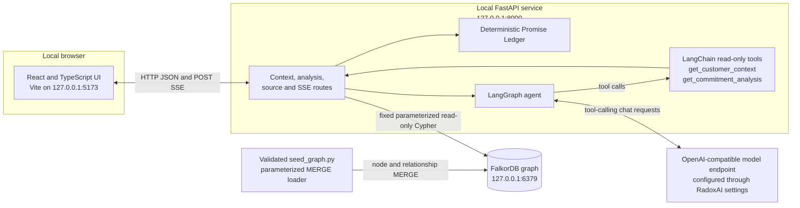
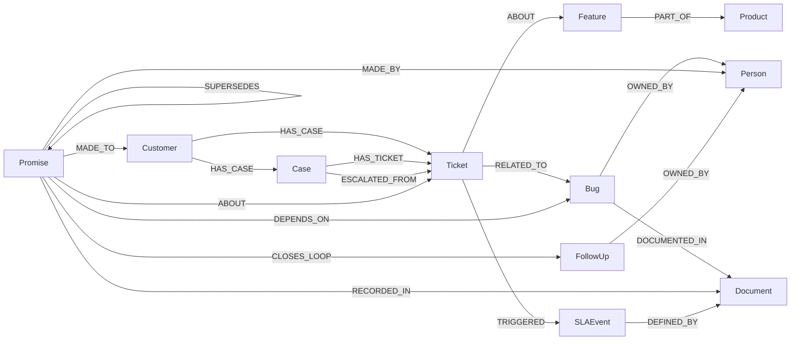

# PromiseGraph

PromiseGraph is a local customer-escalation workspace built with **FalkorDB, FastAPI, LangChain, LangGraph, React, and TypeScript**. It connects support history, customer promises, product bugs, owners, follow-ups, and service-level evidence in a property graph, then helps an operator investigate that connected evidence.

The included **Bluepeak Robotics** dataset is synthetic. The application provides a searchable case timeline, a deterministic Promise Ledger, source inspection with graph provenance, an agent that streams tool progress, and a reviewable customer-update draft. It does not send messages or write operational changes to FalkorDB.

## Contents

- [Features](#features)
- [Architecture](#architecture)
- [Graph data model](#graph-data-model)
- [Cypher and analysis algorithms](#cypher-and-analysis-algorithms)
- [Requirements](#requirements)
- [Installation and startup](#installation-and-startup)
- [Using the application](#using-the-application)
- [API reference](#api-reference)
- [Tests and build](#tests-and-build)
- [Project structure](#project-structure)
- [Security and operating boundaries](#security-and-operating-boundaries)

## Features

- **Connected escalation context:** joins repeat tickets to a shared bug, its current engineering owner, customer promises, and SLA evidence.
- **Promise Ledger:** classifies promises as overdue, open, date-unclear, or closed, then ranks overdue promises with a transparent deterministic score.
- **Evidence timeline:** displays ticket, promise-due, and SLA events chronologically. Search by record ID or text and filter by event type.
- **Source inspector:** open a source ID from the timeline, answer, Promise Ledger, or evidence path to inspect its fields and connected relationships.
- **LangGraph investigation:** the server-bound agent must call both read-only tools—customer context and commitment analysis—before answering. It validates citations against IDs returned by those tools.
- **Live tool-progress loader:** the API emits Server-Sent Events (SSE) for progress and tool start/finish events, followed by the completed answer. This is event streaming, not token-by-token answer streaming.
- **Reviewable draft:** prepares editable customer text with separate internal evidence and safety checks. The app has no send action.
- **Operator aids:** suggested questions, a browser-local checklist, and a downloadable Markdown case brief.

## Architecture



The frontend talks only to FastAPI. The backend performs fixed graph reads and creates the agent. The model sees graph evidence only when the server-bound tools return it; it cannot select arbitrary customer IDs, submit Cypher, or update the database. The seed script is the separate, explicit write path used during local setup.

## Graph data model

The graph uses FalkorDB's property-graph model: labeled nodes represent entities and typed, directed relationships represent how those entities connect. Records use a stable `id` property. The demo seed contains **19 nodes and 32 relationships**.



### Node labels and principal properties

| Label | Purpose | Seed properties |
|---|---|---|
| `Customer` | Account/customer record | `id`, `name`, `segment`, `account_owner_id` |
| `Case` | Current escalation case | `id`, `status`, `opened_at`, `priority`, `tenant_id` |
| `Ticket` | Support history | `id`, `created_at`, `summary`, `status`, `source_ref`, `tenant_id` |
| `Promise` | A customer-facing commitment | `id`, `text`, `created_at`, `due_at`, `status`, `confidence`, `evidence_excerpt`, `source_ref`, `tenant_id` |
| `FollowUp` | Closure action for a promise | `id`, `status`, `due_at`, `completed_at`, `tenant_id` |
| `Bug` | Engineering issue | `id`, `title`, `status`, `severity`, `known_since`, `source_ref`, `tenant_id` |
| `Person` | Account, support, or engineering owner | `id`, `name`, `role`, `team` |
| `SLAEvent` | Service-level event | `id`, `kind`, `occurred_at`, `target_at`, `source_ref`, `tenant_id` |
| `Document` | Source material such as call notes, issue notes, or contract clauses | `id`, `kind`, `title`, `source_ref`, `excerpt`, `occurred_at`, `tenant_id` |
| `Feature` | Product capability affected | `id`, `name` |
| `Product` | Product area | `id`, `name` |

The model is intentionally small and optimized for the demo's support-escalation joins. The dataset contains three linked tickets (`TKT-201`, `TKT-228`, `TKT-251`), two promises (`PROM-22`, `PROM-31`), one current bug (`BUG-77`), two follow-ups, one SLA event (`SLA-09`), and supporting call, engineering, and contract documents.

### Relationship types

`HAS_CASE` connects a customer to a case or its tickets. `HAS_TICKET` connects a case to its current ticket. `ESCALATED_FROM` links the current case to earlier tickets. `RELATED_TO` links tickets to bugs. `ABOUT` links tickets to features or promises to tickets. `PART_OF` links a feature to its product.

`MADE_TO`, `MADE_BY`, and `RECORDED_IN` connect a promise to its customer, maker, and source. `DEPENDS_ON` connects a promise to a bug, while `SUPERSEDES` links a later promise to an earlier one. `CLOSES_LOOP` connects a promise to its follow-up, and `OWNED_BY` assigns bugs or follow-ups to a person. `DOCUMENTED_IN` connects a bug to its engineering notes. `TRIGGERED` links a ticket to an SLA event, and `DEFINED_BY` links the event to the governing contract document.

The seed includes `tenant_id` on the tenant-scoped records that need it for the demo. The current API is a single-customer local prototype; it is not a production multi-tenant authorization system.

## Cypher and analysis algorithms

### Cypher patterns used

The API uses FalkorDB's official Python client and sends fixed Cypher strings with parameters. Graph reads use `ro_query`; the backend does not accept Cypher from the browser or the LLM.

A ticket-to-bug-to-owner traversal follows the repeated issue to its engineering owner:

```cypher
MATCH (c:Customer {id: $customer_id})-[:HAS_CASE]->(t:Ticket)
      -[:RELATED_TO]->(b:Bug)-[:OWNED_BY]->(owner:Person)
RETURN DISTINCT t.id, b.id, b.title, b.status, owner.id, owner.name
ORDER BY t.id
```

The promise query uses `OPTIONAL MATCH` because maker, source, bug, and follow-up information can be missing in some records:

```cypher
MATCH (p:Promise)-[:MADE_TO]->(c:Customer {id: $customer_id})
OPTIONAL MATCH (p)-[:MADE_BY]->(maker:Person)
OPTIONAL MATCH (p)-[:RECORDED_IN]->(source)
OPTIONAL MATCH (p)-[:DEPENDS_ON]->(bug:Bug)
OPTIONAL MATCH (p)-[:CLOSES_LOOP]->(follow:FollowUp)
RETURN p.id, p.text, p.created_at, p.due_at, p.status,
       p.evidence_excerpt, maker.name, source.id, bug.id, follow.status,
       p.confidence
ORDER BY p.due_at
```

The SLA traversal joins customer, case, ticket, event, and contract:

```cypher
MATCH (c:Customer {id: $customer_id})-[:HAS_CASE]->(case:Case)
      -[:HAS_TICKET]->(t:Ticket)-[:TRIGGERED]->(sla:SLAEvent)
      -[:DEFINED_BY]->(contract:Document)
RETURN DISTINCT case.id, t.id, sla.id, sla.kind, sla.occurred_at,
                sla.target_at, contract.id, contract.title, contract.excerpt,
                case.priority
```

Other API queries use `MATCH`, property predicates, `RETURN`, `DISTINCT`, `ORDER BY`, `count`, and bounded `LIMIT`. Source inspection traverses incoming and outgoing relationships but restricts adjacent nodes to an allowlist of IDs already associated with the selected customer. All values, including customer and record IDs, are passed as query parameters.

The seed loader validates labels and relationship types against an identifier allowlist, validates unique IDs and edge endpoints, then loads nodes and relationships with `MERGE`. For example, a `Customer` node is loaded in this form:

```cypher
MERGE (n:Customer {id: $id})
SET n += $properties
```

A typed relationship is loaded by matching the two validated endpoints and merging the relationship:

```cypher
MATCH (a {id: $from_id}), (b {id: $to_id})
MERGE (a)-[:HAS_CASE]->(b)
```

Node labels and relationship types are inserted only after identifier validation; property values and IDs are parameters. Running the seed again refreshes supplied properties and avoids creating duplicate matching nodes/edges; it does not delete records.

### Promise status and debt score

Promise status and score are calculated in Python by `backend/commitment_analysis.py`; they do not depend on an LLM or graph algorithm. At runtime, the default analysis time is the current UTC time. A promise with a closed status is classified as `closed`; one without a parseable due date is `date_unclear`; a due date at or before the analysis time is `overdue`; otherwise it is `open`.

For overdue promises, the heuristic is:

```text
debt = impact_weight × overdue_days_weight × repetition_weight × confidence_weight

overdue_days_weight = min(1 + overdue_days / 7, 3)
repetition_weight   = 1 + 0.25 × other_overdue_promises
```

Priority impact weights are `critical = 3.0`, `high = 2.0`, `medium = 1.5`, and `normal` or `low = 1.0`. Confidence is clamped to the interval `[0.5, 1.0]`; invalid or missing confidence defaults to `0.5`. Non-overdue promises receive a score of zero. Results are sorted from highest to lowest score, with each factor returned for inspection. This is a transparent **demo triage heuristic**, not a calibrated prediction of churn or business risk.

### Graph algorithms not used

The app does **not** run PageRank, centrality, shortest-path search, community detection, vector search, a graph embedding model, FalkorDB GraphRAG, or a graph data science library. Its graph reasoning is explicit Cypher pattern traversal. Its commitment ranking is the deterministic formula above. The LLM summarizes retrieved evidence; it does not compute the graph paths or commitment score.

## Requirements

- Docker Desktop or Docker Engine with the Docker Compose plugin.
- Python 3.11 or newer.
- Node.js 20 or newer and npm.
- A RadoxAI API key and a configured model endpoint that supports OpenAI-compatible tool calling for the Ask Agent and Draft features.

The dashboard, source inspection, and deterministic Promise Ledger require FalkorDB and the API, but do not require model credentials. Agent investigation and draft generation require the model credentials. The included Docker Compose service uses the official `falkordb/falkordb:latest` image, exposes the FalkorDB Browser on port `3000`, and the database on port `6379`. See [FalkorDB's Docker documentation](https://docs.falkordb.com/operations/docker).

## Installation and startup

Run all commands from the project root unless the step says otherwise. Keep three terminals open: one for FalkorDB, one for the API, and one for Vite.

### 1. Start FalkorDB

```bash
docker compose up -d
```

The service binds both ports to loopback (`127.0.0.1`) and stores database files in the named volume `promisegraph-falkordb-data`. Open [http://127.0.0.1:3000](http://127.0.0.1:3000) to browse the graph. The local demo has no database password; do not expose the database or browser ports to a public network.

To stop the service without removing its data:

```bash
docker compose down
```

The database volume persists. Removing it with `docker compose down -v` permanently deletes the local FalkorDB volume and all data stored in that volume.

### 2. Create the backend environment

#### macOS and Linux

```bash
python3 -m venv .venv
source .venv/bin/activate
python -m pip install --upgrade pip
pip install -r backend/requirements.txt
cp .env.example .env
```

#### Windows PowerShell

```powershell
py -3 -m venv .venv
.\.venv\Scripts\Activate.ps1
python -m pip install --upgrade pip
pip install -r backend/requirements.txt
Copy-Item .env.example .env
```

The `.env.example` file is the complete configuration template. Put your RadoxAI key in `RADOXAI_API_KEY` in the local `.env` file. The template defaults to `RADOXAI_BASE_URL=https://radoxai.com/v1` and `PROMISEGRAPH_MODEL=claude-opus-4.8`; use a model available to your account that supports tool calling. The backend also reads `FALKORDB_HOST`, `FALKORDB_PORT`, and `FALKORDB_GRAPH`. Its model client uses `RADOXAI_API_KEY`, with `OPENAI_API_KEY` as a fallback key name. Credentials stay in the backend environment and are never needed by the React frontend.

`.env` is excluded from Git by the root `.gitignore` and is not included in project archives.

### 3. Validate and load the sample graph

With the Python virtual environment active, run:

```bash
python scripts/seed_graph.py --dry-run
python scripts/seed_graph.py
```

The dry run validates the JSON and prints the graph name and counts without connecting to FalkorDB. The regular command loads the 19 synthetic nodes and 32 relationships idempotently into the configured graph. It does not delete existing data. If `FALKORDB_GRAPH` differs from the dataset's `promisegraph_demo`, the loader warns and uses the configured graph name.

### 4. Start the FastAPI backend

From the project root, with the virtual environment active:

```bash
python -m uvicorn backend.main:app --reload --host 127.0.0.1 --port 8000
```

Confirm that the graph is reachable:

```text
http://127.0.0.1:8000/health
```

A healthy response includes `status`, graph name, and node count. The interactive API page is at [http://127.0.0.1:8000/docs](http://127.0.0.1:8000/docs).

### 5. Start the React frontend

In a new terminal, from the project root:

```bash
cd frontend
npm ci
npm run dev
```

Open [http://127.0.0.1:5173](http://127.0.0.1:5173). The Vite server binds to `127.0.0.1` and the frontend calls the API at `http://127.0.0.1:8000` by default. The backend CORS configuration allows the local Vite origins `http://localhost:5173` and `http://127.0.0.1:5173`.

### 6. Stop the application

Stop FastAPI and Vite with `Ctrl+C` in their terminals. Stop the database container with `docker compose down`; this keeps the named database volume for the next run.

## Using the application

1. Confirm the sidebar reports **Graph connected** and the case data is visible.
2. Review the case summary, commitment score, overdue commitments, SLA event, and related tickets.
3. Search for `PROM-22` or filter the timeline to commitments. Open timeline IDs and citations to inspect their source fields and permitted graph relationships.
4. In **Ask the case agent**, enter a question or select a suggested prompt, then submit. The loader shows both read-only tools starting and completing. The completed answer reports whether its citations are grounded in tool-returned IDs.
5. Use **Prepare response** to generate an editable customer-update draft. Review the draft, internal evidence, and warnings. The application has no send button.
6. Use the operator checklist for a browser-local reminder and **Export brief** to download a Markdown handoff snapshot. Checklist state is stored only in that browser; neither feature updates FalkorDB.

### Demo case facts

The seed describes a repeated CSV export issue across `TKT-201`, `TKT-228`, and `TKT-251`, connected to open bug `BUG-77`. `PROM-22` records an export-fix commitment due October 14; `PROM-31` records a status-update commitment due October 15. Both associated follow-ups are open. `Riya Kulkarni` is the recorded engineering owner. `SLA-09` records a first-response breach, and `BLUEPEAK-CONTRACT-1` states the one-hour initial-response target but does not guarantee a bug-fix delivery date. The records do not establish a new confirmed engineering ETA. All dates and records are part of the synthetic demo dataset.

## API reference

All routes are served by FastAPI at `http://127.0.0.1:8000`. The customer ID in the included seed is `CUST-BLUEPEAK`.

| Method and path | Purpose |
|---|---|
| `GET /health` | Query the selected graph and return status, graph name, and node count. |
| `GET /api/customers/{customer_id}/context` | Return the customer, connected tickets, ticket-to-bug-owner paths, promises, and SLA/contract evidence. |
| `GET /api/customers/{customer_id}/analysis` | Return customer context plus deterministic promise scores and ranking. |
| `GET /api/customers/{customer_id}/sources/{source_id}` | Resolve a source only if its ID is in the customer's evidence allowlist, then return its record and related graph edges. |
| `POST /api/customers/{customer_id}/ask` | Return a non-streaming evidence-checked agent answer. Request JSON: `{"question":"Why did this case escalate?"}`. |
| `POST /api/customers/{customer_id}/ask/stream` | Stream investigation progress, tool lifecycle events, and the final evidence-checked answer as SSE. Uses the same question JSON body. |
| `POST /api/customers/{customer_id}/draft-reply/stream` | Stream tool progress and a safety-checked, editable, unsent customer-update draft. No request body is required. |

For the streaming endpoints, the browser sends a POST request with `Content-Type: application/json` for the investigation endpoint and consumes `text/event-stream`. Investigation events include `progress`, `tool_start`, `tool_finish`, `answer`, and `done`; failures may produce `error`. The draft route emits the tool lifecycle events and a `draft` result. The model's final response is delivered after the tool calls complete; the user interface does not stream generated answer tokens individually.

Example context request:

```bash
curl http://127.0.0.1:8000/api/customers/CUST-BLUEPEAK/context
```

Example non-streaming agent request:

```bash
curl -X POST http://127.0.0.1:8000/api/customers/CUST-BLUEPEAK/ask \
  -H 'Content-Type: application/json' \
  -d '{"question":"Why is this account escalating? Separate known facts from uncertainty."}'
```

## Tests and build

Run from the project root. Activate the Python virtual environment first.

```bash
python scripts/seed_graph.py --dry-run
python -m py_compile backend/main.py backend/agent_workflow.py scripts/seed_graph.py
python -m unittest discover -s backend -p 'test_*.py' -v
cd frontend
npm ci
npm run build
```

The backend suite covers commitment scoring, draft safety rules, seed validation and idempotent query construction, customer-scoped source access, and the LangGraph tool cycle. The agent integration test runs the real LangGraph/ChatOpenAI workflow against a local OpenAI-compatible mock server; it does not contact RadoxAI or FalkorDB. The frontend build runs TypeScript type checking and creates the production bundle in `frontend/dist/`.

## Project structure

```text
promisegraph/
├── README.md
├── .env.example
├── docker-compose.yml
├── data/
│   └── bluepeak_seed.json
├── scripts/
│   └── seed_graph.py
├── backend/
│   ├── main.py
│   ├── agent_workflow.py
│   ├── commitment_analysis.py
│   ├── requirements.txt
│   └── test_*.py
└── frontend/
    ├── package.json
    ├── package-lock.json
    ├── index.html
    └── src/
        ├── App.tsx
        ├── main.tsx
        └── styles.css
```

## Security and operating boundaries

This is a local hackathon demonstration, not a production deployment. The included Compose configuration binds database and browser ports to loopback but does not configure a database password. Do not expose those ports to the internet or a shared network.

The backend has no user authentication or production tenant authorization. CORS is limited to the two local Vite origins, but CORS is not authentication. The API's fixed queries and source allowlist reduce accidental exposure in the single-customer demo; they are not a substitute for production identity, authorization, and tenant isolation.

The agent has two read-only tools. The model cannot write Cypher or graph records, and it cannot send customer communication. Citation validation checks that referenced IDs were returned by the available tools; it does not independently prove every natural-language claim. Draft validation flags certain unsupported formats, dates, or internal record IDs; it is a review aid, not a guarantee. A human must verify any proposed wording against current operational systems.

The checklist is browser-local, the case brief is a downloaded snapshot, and neither is an audit log or a source-system write-back. All included Bluepeak data is synthetic.
